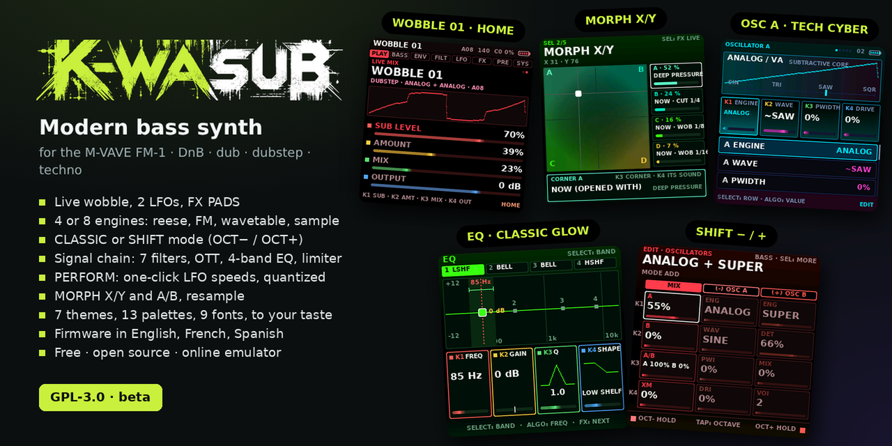

<p align="center"></p>

# K-WASUB · FM1 modern Bass firmware

**English** · [Français](fr/README.md) · [Español](es/README.md)

**A modern bass synth for the M-VAVE FM-1**: DnB, dub, dubstep, techno. Live wobble, reese, sub, 808, an EQ, a morph between four sounds, effects on the keys. Free and open source (GPL-3.0). *Version 1.0.*

| | |
|---|---|
| 🎛 **Try it** (browser) | [`emulator/index.html`](emulator/index.html)  |
| ⬇️ **Install** on the FM-1 | [`installer.html`](installer.html) (Chrome or Edge, USB) · or `INSTALL-Windows.bat` / `INSTALL-Mac.command` / `INSTALL-Linux.sh` |
| 📖 **Manual** (illustrated) | [`manual.html`](manual.html) |
| 🏠 **Home page** | [`index.html`](index.html) (with GitHub Pages on: <https://guizmoh.github.io/K-WASUB_Firmware_for_FM1/>) |
| 🗺 **Specifications** | [`SPECIFICATIONS.md`](SPECIFICATIONS.md): done, to do, ideas |
| 📜 Technical notes | [`docs/TECHNICAL-NOTES.md`](docs/TECHNICAL-NOTES.md) |
| 🇫🇷 French | [`fr/`](fr/): the home page, manual, specifications and notes in French |
| 🇪🇸 Spanish | [`es/README.md`](es/README.md): the README in Spanish |

## Key features

1. **4 efficient engines** for modern basses, or **8 engines** for bass, pads & leads (`SYSTEM › ENGINES`).
2. **Drum sequencer with conditions & parameter locks** (on the bass too: hold a step, turn a knob) and **automation** (hold REC while it plays and turn any knob; hold REC alone to erase): 8 coloured tracks (808, 909, dub techno, acoustic kits), chance and trig conditions on every step, black keys choose the instrument, white keys (pads) place its steps, OCT−/OCT+ turn the pages; live REC; sync out for Pocket Operators and Volcas.
3. **LFO learn**: hold `LFO` and turn any knob, LFO 2 is assigned to that setting in one gesture.
4. **CLASSIC** or **SHIFT** mode (`OCT−` / `OCT+`) for a faster workflow, chosen in the options.
5. **SEL windows**: PERFORM, MORPH, FX LIVE, MACROS.
6. **A/B morph**: blend two sounds live.
7. A live **LFO page** to reshape your wobble basses while you play.
8. **SEQ BASS** (up to 64 steps, probability, trig conditions and note length per step, 30 presets, live REC), **OSC C** samples (attacks, textures; start / end cut, faster or slower, reverse, ping-pong), **DRUMS** (808 / 909 / dub techno / acoustic kits, 8 coloured tracks, rhythm presets: techno, dub, dnb…), **ARP**, **MIDI**.
9. The sound: engines, filters, effects, master, and **FX PADS**.
10. Animated oscillator visuals, live.
11. A visual **EQ**.
12. Totally different **themes**, to fit the way you work.
13. **Brightness**, contrast, fonts and size.
14. **Firmware language** (`SYSTEM › LANGUAGE`): English, Français or Español; English by default.

## Install

1. FM-1 over USB (a **data** cable), other MIDI software closed.
2. Open [`installer.html`](installer.html) in Chrome or Edge → “Install K-WASUB”.
3. The packages are in [`install/`](install/) (`k-wasub-X.fwsc`, older ones in `install/older/`, checksums in `SHA256SUMS`).

You can go back to KAWA (`install/kawa-0.5.fwsc`) or to the stock firmware (M-UPGRADE) at any time; holding `OCT−` at power-on = USB rescue.

## Build

```sh
cd source
./build.sh --release 1.0.3          # -> build/k-wasub-1.0.3.fwsc
APP_VER=1.0.3 bash web/make_emulator.sh      # emulator
bash web/make_installer.sh                    # installer.html with the newest package
bash tests/run_stress.sh                      # load tests (UBSan)
python3 tests/manual_shots.py                 # the manual's screenshots (docs/img)
```
JieLi toolchain and AC79 SDK: see `source/BUILDING.md` and `source/tools/get_toolchain.sh`.

## Support

☕ [ko-fi.com/omnipotard](https://ko-fi.com/omnipotard)

## Credits and license

GPL-3.0. K-WASUB is born from [KAWA](https://github.com/Guizmoh/Kawa-Tracker-Fm1) (Omnipotard / Leo Kuroshita, Hügelton Instruments), whose FM-1 platform it reuses (boot, USB, audio, screen). See [`LICENSING.md`](LICENSING.md). Not affiliated with M-VAVE.
