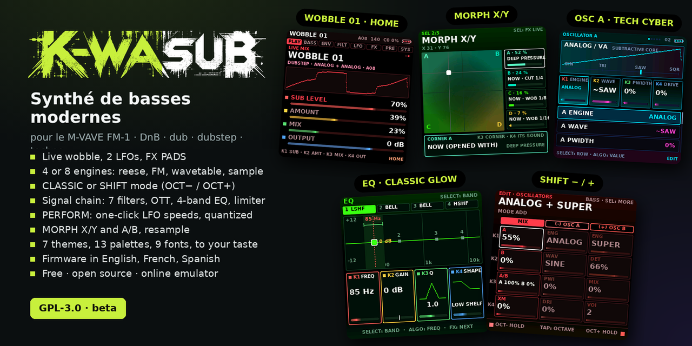

<p align="center"></p>

# K-WASUB · FM1 modern Bass firmware

**English** : [README](../README.md) · **Français** : cette page

**Synthé de basses modernes pour le M-VAVE FM-1** : DnB, dub, dubstep, techno. Wobble en direct, reese, sub, 808, un EQ, un morph entre quatre sons, des effets sur les touches. Gratuit et libre (GPL-3.0). *Beta.*

| | |
|---|---|
| 🎛 **Essayer** (navigateur) | [`emulator/index.html`](../emulator/index.html?lang=fr)  |
| ⬇️ **Installer** sur le FM-1 | [`installer.html`](../installer.html) (Chrome ou Edge, USB) · ou `INSTALL-Windows.bat` / `INSTALL-Mac.command` / `INSTALL-Linux.sh` |
| 📖 **Manuel** illustré | [`manual.html`](manual.html) |
| 🏠 **Accueil** | [`index.html`](index.html) (si GitHub Pages est activé : <https://guizmoh.github.io/K-WASUB_Firmware_for_FM1/>) |
| 🗺 **Cahier des charges** | [`CAHIER-DES-CHARGES.md`](CAHIER-DES-CHARGES.md) : fait, à faire, idées |
| 📜 Notes techniques | [`NOTES-TECHNIQUES.md`](NOTES-TECHNIQUES.md) |

## Ce que ça fait

- **Jouer** : les 27 touches jouent la basse, `K1`–`K4` règlent les quatre réglages importants de chaque page.
- **Wobble** : `LFO` maintenu + un potard branche le LFO 2 sur ce que règle le potard (le LFO 1 si vous préférez : `SYSTEM › LFO HELD = LFO`).
- **FX PADS** : `FX` maintenu, les touches blanches changent la vitesse du wobble (4, 8, 16, 24, 32, 48), les noires jouent stutters, tape stop, DJ filter, saturation, phaser…
- **MORPH** : `SEL` ×2 = carré X/Y (au départ, le même son en 4 variantes), ×5 = fondu A/B sur le tempo.
- **Deux modes** : CLASSIC (listes) ou SHIFT (3 colonnes, `OCT−` et `OCT+` comme Shift) ; `GLO` maintenu pour basculer.
- **PERFORM** (`SEL`) : 4 macros nommées, le morph et les pads sur un seul écran.
- **Son** : OTT multibande, MONO BASS, sub verrouillé sur OSC A, **RESAMPLE** (la sortie dans OSC C, à rejouer, ralentir, boucler).
- **Presets** : tags (sub, reese, growl, wobble, pluck, 808, drone), changement immédiat.
- **Sortie** : DEEP BASS, limiteur, AUTO LEVEL ; si le FM-1 s'arrête, `LAST STOP` dit pourquoi.

## Installer

1. FM-1 en USB (câble **de données**), autres logiciels MIDI fermés.
2. Ouvrir [`installer.html`](../installer.html) dans Chrome ou Edge → « Installer K-WASUB ».
3. Les paquets sont dans [`install/`](../install/) (`k-wasub-X.fwsc`, anciens dans `install/older/`, sommes de contrôle dans `SHA256SUMS`).

Retour à KAWA (`install/kawa-0.5.fwsc`) ou au firmware officiel (M-UPGRADE) possible à tout moment ; `OCT−` maintenu à l'allumage = secours USB.

## Construire

```sh
cd source
./build.sh --release 0.9.26          # -> build/k-wasub-0.9.26.fwsc
APP_VER=0.9.26 bash web/make_emulator.sh      # émulateur
bash web/make_installer.sh                    # installer.html avec le dernier paquet
bash tests/run_stress.sh                      # tests de charge (UBSan)
python3 tests/manual_shots.py                 # captures du manuel (docs/img)
```
Toolchain JieLi et SDK AC79 : voir `source/BUILDING.md` et `source/tools/get_toolchain.sh`.

## Crédits et licence

☕ **Soutenir** : [ko-fi.com/omnipotard](https://ko-fi.com/omnipotard)

GPL-3.0. K-WASUB est né de [KAWA](https://github.com/Guizmoh/Kawa-Tracker-Fm1) (Omnipotard / Leo Kuroshita, Hügelton Instruments), dont il reprend la plate-forme du FM-1 (démarrage, USB, audio, écran). Voir [`LICENSING.md`](../LICENSING.md). Non affilié à M-VAVE.
